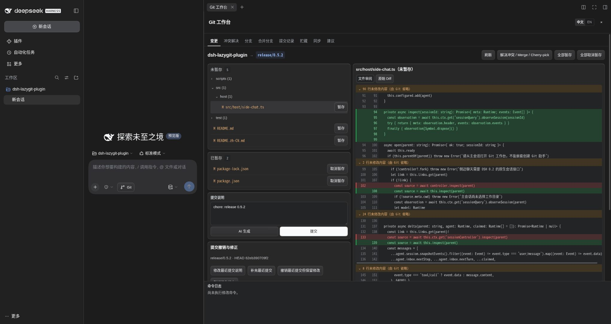

<div align="center">

# DSH LazyGit Plugin

**See your Git history and changes. Run everyday Git operations with a few clicks.**

A visual Git workbench inside DeepSeek Harness Web.


[](https://www.npmjs.com/package/dsh-lazygit-plugin)
[](https://github.com/IT-coder-Yy/dsh-lazygit-plugin)
[](LICENSE)
[](https://linux.do)

English · [简体中文](README.zh-CN.md)

</div>

## Preview



## Git you can see and use

**Understand your repository at a glance.** Browse the commit graph, inspect commit details and file diffs, compare staged and unstaged changes, and see branches, tags, stashes, and remote sync status in one workbench.

**Click through everyday Git work.** Stage files, commit, switch branches, merge, stash, fetch, pull, and push from the interface. Preview changes before merging and resolve conflicts in the built-in three-pane editor.

| Area | What you can do |
| --- | --- |
| Changes | Browse changed files by directory; review diffs with old/new line numbers and independently scrollable hunks, or switch to raw diffs; stage or unstage individual files or all changes; write a multiline message or use **AI Generate** to draft a Conventional Commit. |
| History | Browse the graph, inspect messages, parents, changed files and diffs; amend, undo, or revert commits. |
| Branches | Search, create, switch, and delete local branches; inspect remote branches and tags. |
| Merge | Preview incoming commits and changes; choose normal, fast-forward-only, or squash merge. |
| Conflicts | Compare current, incoming, and result panes; accept either side, keep both, or edit manually; save, resolve, and continue. |
| Stashes | Stash all or selected files, optionally including untracked files; review, apply, pop, drop, or create a branch from a stash. |
| Sync | Inspect upstream and ahead/behind counts; fetch, fast-forward pull, push, set upstream, and manage Rebase. |
| Suggestions | Chat with the independent Git assistant; review commands, explanations, and risks; execute a proposal step by step or copy it for manual execution; diagnose failures and review proposed fixes. |

The command log at the bottom of the workbench shows the Git commands submitted through the interface and their running, success, or failure status. The workbench follows the host's light or dark theme.

## Quick start

Requires Git, Node.js `^22.19.0 || >=24.0.0`, and DeepSeek Harness Web. DSH `0.2.2-alpha.2` requires Node.js `>=24.9.0`.

If you installed `dsh-easygit-plugin` before, stop the Harness backend and run `dsh plugin --profile web remove dsh-easygit-plugin` before installing the new package below. Existing assistant session links and proposal records are imported once, preserving the original storage and any records already present under the new name. For a manual installation, replace the old mount with the `lazygit` entry in [lazygit.cordis.yml](lazygit.cordis.yml). Refresh the browser after restarting.

```sh
npm install -g @deepseek-ai/dsh@0.2.1-rc.5
dsh plugin --profile web add dsh-lazygit-plugin@0.5.2
dsh web
```

Open a session for your Git repository, then click the **Git** button beside the composer. The workbench opens in a native right-sidebar tab.

Use the compact **中文 / EN** control in the title bar to switch the workbench language. Your browser remembers the selection. Switching preserves the current tab and unsaved input; file paths, commit content, and raw Git output remain unchanged.

A typical workflow: **Changes → review the diff → stage files → enter a message → commit → Sync → push**. New branches can set their upstream when pushing.

If pnpm blocks installation because the package was recently published, add the package to the existing configuration in `~/.dsh/profiles/web/pnpm-workspace.yaml`:

```yaml
minimumReleaseAgeExclude:
  - dsh-lazygit-plugin
```

## Common workflows

### Review changes and generate a commit message

In **Changes**, select a file from the staged or unstaged directory tree to inspect its diff. Stage the changes you want to commit, then enter a message or click **AI Generate**. Manual messages can include a subject and a multiline body.

AI generation uses the main session's selected model, falling back to the default model. It sends the staged diff and bounded project context (tracked filenames, recent commit subjects, and staged README/package metadata) to that model, then fills in a single-line Chinese Conventional Commit message for you to review. It requires a configured model and staged changes; an oversized diff must be split into smaller staged batches. If the index changes during generation, generate again before committing.

### Work with the Git assistant

Open **Suggestions → Expand Git assistant chat**. The assistant starts with the main conversation's context and model selection; later conversation updates are synchronized, while its model settings can be changed independently. Context synchronization alone does not start an assistant turn.

Describe your goal, review the proposed commands and their risks, then execute them in the workbench. The assistant can read repository state and diffs and register proposals; repository changes require your click. Multi-step proposals run in order and stop at the first failure. High-risk proposals require an additional risk acknowledgment, and changes to the repository or session working directory invalidate pending proposals.

You can also copy commands for manual execution and use **Recheck** to check supported expected outcomes. A detected repository change alone does not prove that a command succeeded. Completed or failed proposals cannot be executed again; retry through a new proposal.

When an operation fails, the workbench retains command output and repository diagnostics. Recognized cases can offer a corrective proposal; failures requiring assistant analysis are sent to the Git assistant automatically. You can cancel or retry analysis, or expand the chat to provide missing information. Any proposed repair still requires your confirmation before execution.

### Amend, undo, or revert a commit

Open **Changes → Commit edits** for the latest commit, or click a commit in **History**.

- **Edit the latest message** changes only the message, preserving staged and working-tree changes.
- **Amend the latest commit** adds all staged changes while keeping its message.
- **Undo the latest commit, keep changes** uses `reset --soft` to return to its first parent; the initial commit cannot be undone this way.
- **Revert a commit** creates a reverse commit and requires a clean worktree and index. For merge commits, select the mainline parent. Conflicts can be continued, aborted, or skipped from Conflict resolution.

These actions require confirmation. Amend and undo rewrite local history and can affect published commits; the plugin never force-pushes automatically. If the branch, HEAD, or index changes after loading, refresh before confirming again.

### Preview and merge branches

Open **Merge**, select a local or fetched remote branch, and preview its incoming commits and file changes. Choose normal merge, fast-forward only, or squash. Squash stages the combined changes for you to finish as one commit.

Merging requires a clean worktree. Remote sources use locally fetched references, so fetch first for current data. The preview compares the source with the common ancestor; it does not predict conflicts or show the final merge result. A changed branch tip requires a new preview. You can abort an unfinished merge, including squash, but cannot abort a completed merge.

### Resolve conflicts visually

In **Conflicts**, compare the current side, incoming side, and editable result with line numbers and commit references. Choose either side or both per block, or edit the result; then **save → mark resolved → continue**. Merge, Rebase, Cherry-pick, and Revert use this workflow. Abort and supported skip actions require confirmation.

During Rebase, the current side is the target branch plus replayed commits; the incoming side is the commit being replayed. Unresolved markers block resolution, and changed files invalidate an old snapshot. Binary conflicts support whole-side selection; text editing supports up to 48 KiB per version. Use external tools for larger files, symlinks, or submodules. Unsaved drafts last only for the current page and do not survive a reload.

### Save work with Stash

In **Stashes**, select all or individual files and optionally include untracked files. Selected-file stashes preserve unrelated changes. Review a stash before applying it; **apply** retains it, while **pop** removes it only after successful restoration. Conflicts retain the stash and link to Conflict resolution. Creating a branch from a stash requires a clean worktree and starts at the stash's original base.

## Update, remove, or install from source

```sh
# Update / remove
dsh plugin --profile web update dsh-lazygit-plugin
dsh plugin --profile web remove dsh-lazygit-plugin
```

After updating, restart the Harness backend and refresh the browser to load both Host and Client changes.

```sh
# Install from source
git clone https://github.com/IT-coder-Yy/dsh-lazygit-plugin.git
cd dsh-lazygit-plugin
npm install
npm run build
dsh plugin --profile web add "${PWD}"
```

You can also install directly from the repository with `dsh plugin --profile web add github:IT-coder-Yy/dsh-lazygit-plugin`.

## Compatibility

| DSH version | Real-service smoke test | Working directory |
| --- | --- | --- |
| Earlier tested versions (`0.2.0-rc.1`–`0.2.1-rc.3`) | Passed | Original session directory; worktree changes supported from `0.2.1-alpha.2` |
| `0.2.1-rc.4` | Passed | Current directory, including worktree changes |
| `0.2.1-rc.5` | Passed | Current directory, including worktree changes |
| `0.2.2-alpha.2` | Passed | Current directory, including worktree changes |

## Development

```sh
npm install
npm run check
npm pack --dry-run --ignore-scripts
```

`npm run check` runs type checks, tests, and build reproducibility checks. Git integration tests create temporary repositories for repository operations and recovery scenarios.

CI also runs `npm run test:dsh` against all versions covered above, including earlier tested releases. To reproduce one version locally:

```sh
npm install --prefix /tmp/lazygit-dsh-check @deepseek-ai/dsh@0.2.1-rc.5
DSH_INSTALL_DIR=/tmp/lazygit-dsh-check npm run test:dsh
```

The smoke test uses and cleans up a temporary DSH_HOME and Git repository. It does not read existing sessions or call a model.

## License

[MIT](LICENSE)
